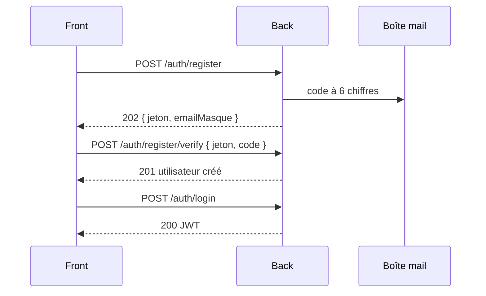

# Authentification

Routes publiques, sans JWT. L'inscription se fait en deux temps : un code à 6 chiffres est envoyé par mail, et l'utilisateur n'est créé qu'une fois ce code saisi.



| Méthode | Route | Rôle |
|---|---|---|
| `POST` | `/auth/register` | Démarre une inscription et envoie le code |
| `GET` | `/auth/register/{jeton}` | Relit une inscription en attente |
| `POST` | `/auth/register/verify` | Valide le code et crée l'utilisateur |
| `POST` | `/auth/register/resend` | Renvoie un nouveau code |
| `POST` | `/auth/login` | Se connecte et obtient le JWT |

## `POST /auth/register`

Démarre une inscription et envoie un code par mail. Le code expire au bout de 15 minutes.

| Champ | Type | Obligatoire | Règle |
|---|---|---|---|
| `nom` | texte | Oui | 100 caractères au plus ; peut servir de pseudo |
| `prenom` | texte | Non | 100 caractères au plus ; vide = aucun |
| `identifiant` | texte | Oui | Identifiant de connexion |
| `motDePasse` | texte | Oui | |
| `email` | texte | Oui | Adresse valide ; mise en minuscules |

```json
{ "nom": "Dupont", "prenom": "Jean", "identifiant": "jdupont01", "motDePasse": "…", "email": "jean@exemple.fr" }
```

**202** : l'inscription attend son code (`DtoInscriptionEnAttente`).

```json
{ "jeton": "8c1e…", "emailMasque": "j****@exemple.fr", "secondesAvantRenvoi": 60 }
```

- `jeton` identifie l'inscription en attente, à la place de l'adresse.
- `emailMasque` garde la première lettre et le domaine.
- `secondesAvantRenvoi` permet d'afficher le décompte avant de pouvoir redemander un code.

Une nouvelle inscription avec la même adresse remplace la précédente, avec un nouveau jeton.

**Adresse déjà inscrite** : la réponse est identique, pour qu'on ne puisse pas tester quelles adresses ont un compte. Mais le titulaire reçoit une alerte au lieu d'un code, et la vérification échouera comme un code incorrect.

## `GET /auth/register/{jeton}`

Relit une inscription en attente, par exemple pour réafficher la saisie du code après un rafraîchissement.

- **200** : `DtoInscriptionEnAttente`, comme ci-dessus.
- **400** : jeton inconnu, ou inscription de plus de 24 heures.

## `POST /auth/register/verify`

Valide le code. L'utilisateur est créé avec le rôle `ROLE_UTILISATEUR` et un premier compte « Compte courant ».

```json
{ "jeton": "8c1e…", "code": "123456" }
```

- **201** : l'utilisateur créé (`DtoUtilisateur`, voir [Utilisateur](utilisateur.md#lutilisateur-dtoutilisateur)).
- **400** : code incorrect (la tentative est comptée), code expiré, ou plus de 5 tentatives. Dans les deux derniers cas, l'inscription est supprimée et il faut recommencer.
- **409** : identifiant ou adresse pris entre-temps par un autre compte. L'identifiant n'est vérifié qu'ici, pour qu'on ne puisse pas tester des identifiants sans posséder la boîte mail.

## `POST /auth/register/resend`

Envoie un nouveau code. L'ancien ne marche plus et le compteur de tentatives repart à zéro.

```json
{ "jeton": "8c1e…" }
```

- **202** : `DtoInscriptionEnAttente`, avec un nouveau délai.
- **400** : jeton inconnu ou inscription trop ancienne.
- **429** : moins de 60 secondes depuis le dernier envoi.

## `POST /auth/login`

```json
{ "identifiant": "jdupont01", "motDePasse": "…" }
```

- **200** : le JWT, **en texte brut** (pas de JSON), valable 24 heures. Au passage, les récurrences en retard de l'utilisateur sont générées.
- **401** : identifiant ou mot de passe incorrect.
