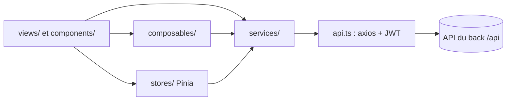

# Architecture du front

Le front est une application Vue 3 + TypeScript, construite avec Vite et Pinia. Les composants n'appellent jamais l'API eux-mêmes : ils passent par les services, qui passent par une instance axios unique.

## Dossiers de `src/`

| Dossier | Rôle |
|---|---|
| `views/` | Écrans routés, nommés `xxxView.vue` (camelCase) |
| `components/` | Composants nommés `XxxComponent.vue` ; sous-dossiers `reglages/`, `assistant/` |
| `services/` | Appels HTTP : `api.ts` (instance axios, JWT, gestion du 401), `comptesService.ts`, `utilisateurService.ts` |
| `stores/` | Stores Pinia en syntaxe setup (`defineStore("nom", () => { … })`) |
| `composables/` | `useReferentiels` : comptes, catégories et libellés partagés entre les écrans |
| `types/` | Types TypeScript alignés sur les DTO du back |
| `utils/` | Formatage (`format.ts`), messages d'erreur (`erreurs.ts`), validation (`validation.ts`)… |
| `styles/` | `theme.css` : variables CSS de la charte « Sapin » |

## Appels à l'API

- `services/api.ts` crée l'instance axios. L'URL de l'API y est écrite en dur (`http://localhost:8085/api`) ; la variable `VITE_BACK_URL` du `.env` n'est pas utilisée.
- L'instance ajoute le JWT à chaque requête (`Authorization: Bearer …`).
- Un intercepteur déconnecte l'utilisateur sur toute réponse 401. C'est pourquoi le back répond 422 à un mot de passe actuel faux (voir [ADR 0005](../../adr/0005-mot-de-passe-actuel-faux-en-422.md)).
- Les types de `types/` reprennent les DTO du back décrits dans [Les objets du back](../back/objets-back.md). Les ids sont des nombres, sauf l'id utilisateur, qui est un UUID en chaîne.

## Configuration

- `.env` et `.env.*` sont ignorés par Git ; le modèle est `.env.example`. `VITE_FRONT_PORT` règle le port du serveur de développement (5173 par défaut).
- L'alias `@` désigne `src/`.

Les conventions de code et de test du front sont dans [`CONTRIBUTING.md`](../../../CONTRIBUTING.md#conventions-du-front).
